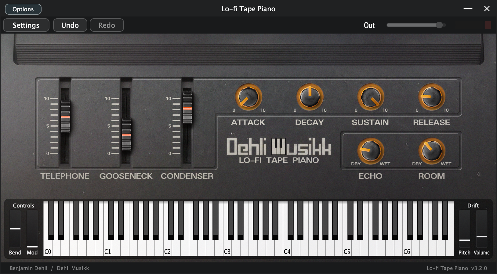

# Lo-fi Tape Piano

**[Product page and documentation](https://benjamindehli.github.io/lo-fi-tape-piano/)**

Lo-fi Tape Piano from Dehli Musikk includes the sound of a Louis Zwicki Pianette recorded with cassette tape recorder through 3 different microphones. The preamps of the tape recorder are slightly overdriven and the tape adds compression and harmonics as well as wow and flutter (pitch variation).

If you want the sound of a perfectly voiced and regulated grand piano, this may not be the samples for you. This is more like a Mellotron / Chamberlin version of the Pianette.

## Release notes

### Version 3.2.0 (2026-11-25)

The changes in this release apply to the plugin version only. The DecentSampler version is unchanged.

- The plugin is now also available for Windows and Linux, as VST3 and Standalone. These versions have not yet been tested on Windows and Linux computers.
- The window can be resized from its own size to twice that, by dragging its bottom-right corner or with the new window size setting in the settings menu. The size is saved with the project.
- Added Undo and Redo buttons. Knob moves, button presses and menu choices can be undone, also with Cmd+Z and Shift+Cmd+Z (Ctrl+Z and Shift+Ctrl+Z on Windows and Linux). Automation is not recorded as steps.
- Every control has a name for screen readers such as VoiceOver, and a screen reader goes through the window in a sensible order.
- The buttons and menus have names in the DAW's automation list instead of numbers. Existing automation of them keeps working.
- If the samples cannot be found, the plugin now says so and where they should be, instead of playing silence.
- The plugin tells the DAW how long its reverb and release tails last, so they are not cut off at the end of an export.
- An optional check for new versions. The first time the plugin opens, it asks whether it may check. It reads one small file from the product page and sends nothing about you. A new version is shown in the bottom strip.
- A damaged value in a saved project or preset is set back to its default instead of reaching the sound.
- Built on JUCE 9.0.6.

### Version 3.1.0 (2026-08-01)

The changes in this release apply to the plugin version only. The DecentSampler version is unchanged.

- Added a translucent overlay graphic on top of the interface.
- Keys that are hovered or held on the keyboard are now shaded in a neutral way instead of turning yellow:
  - White keys turn darker.
  - Black keys turn brighter.
- The computer keyboard keeps playing notes even while you adjust a control with the mouse.

### Version 3.0.0 (2026-07-19)

- Added a plugin version. See the section "The plugin version".
- Added missing sample bindings.

### Version 2.0.0 (2025-04-17)

- Decent Sampler version released

### Version 1.0.0 (2020-05-17)

- EXS version released

## Included formats

- VST3 (macOS, Windows and Linux)
- AU (macOS)
- Standalone application (macOS, Windows and Linux)
- Decent Sampler (macOS, Windows and Linux)

The Windows and Linux versions of the plugin are new and have not yet been tested on those systems.

## The plugin version

The plugin is a self-contained instrument, available as VST3, AU and Standalone.
The graphics are embedded in the plugin, and the samples and impulse responses come in one losslessly compressed file that the installer puts in place, so there is nothing to locate by hand.

The plugin has all the controls and features from the Decent Sampler version, including MIDI learn, the master volume fader with output meter, value readouts for the knobs and full DAW automation.
On top of that, the plugin version adds:

- Drift wheels next to the pitch and modulation wheels, adding a subtle random pitch and volume drift to each voice.
- A velocity curve setting in the settings menu.
- A resizable window, from its own size to twice that.
- Undo and Redo.

## The Decent Sampler version

This version of Lo-fi Tape Piano is an instrument preset / sample library for Decent Sampler. If you're new to Decent Sampler, I recommend checking out [this guide][Decent Sampler guide] first.

## Technical specification

|                           | Sample rate | Bit depth | Channels   | Number of files | File size |
| ------------------------: | ----------: | --------: | ---------- | --------------: | --------: |
| **Telephone mic samples** |      48 kHz |    24 bit | 1 (mono)   |              82 | 159.70 MB |
| **Gooseneck mic samples** |      48 kHz |    24 bit | 1 (mono)   |              82 | 159.70 MB |
| **Condenser mic samples** |      48 kHz |    24 bit | 2 (stereo) |              82 | 318.20 MB |
|     **Impulse responses** |      48 kHz |    24 bit | 2 (stereo) |               2 |   1.70 MB |

## User Interface

||
|:--:|
|Overview|

## About this repository

This repository contains the source for both the Decent Sampler library (the DecentSampler folder) and the plugin version.
The plugin is a thin wrapper around the shared Dehli Musikk sampler engine, and a converter translates the Decent Sampler library into the engine's native preset format at build time.
The audio files are not part of this repository, since the samples are a paid product.
The full version is available from [store.dehlimusikk.no][Gumroad profile].

[Gumroad profile]: https://store.dehlimusikk.no/
[Decent Sampler guide]: https://www.decentsamples.com/how-to-use-decent-sampler/
